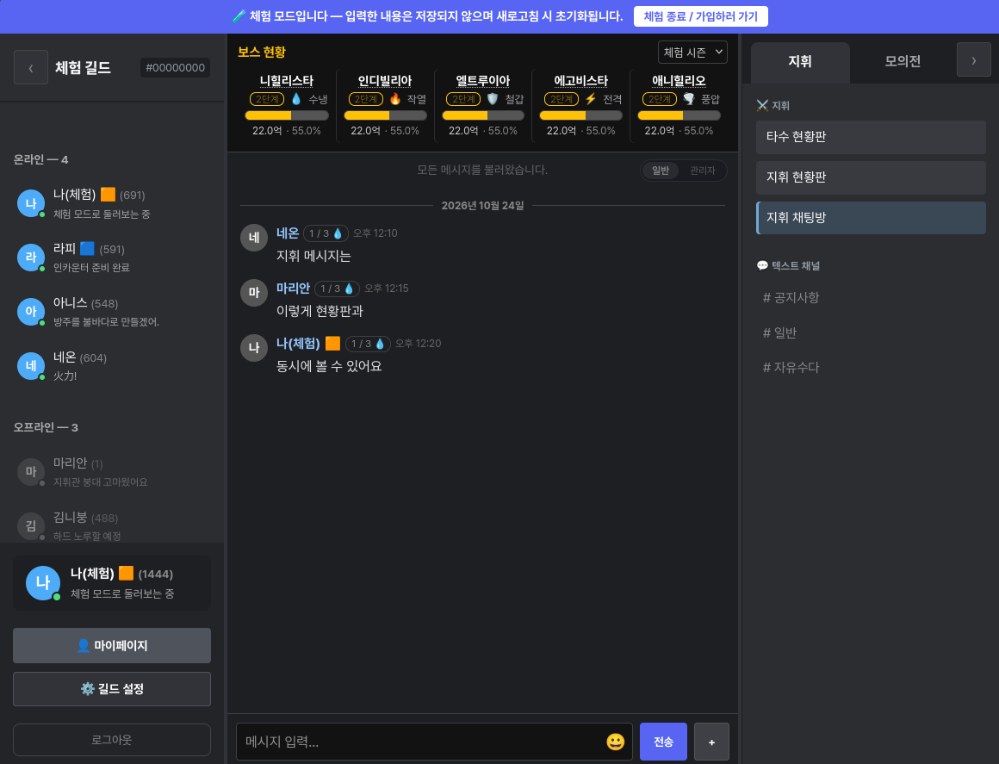
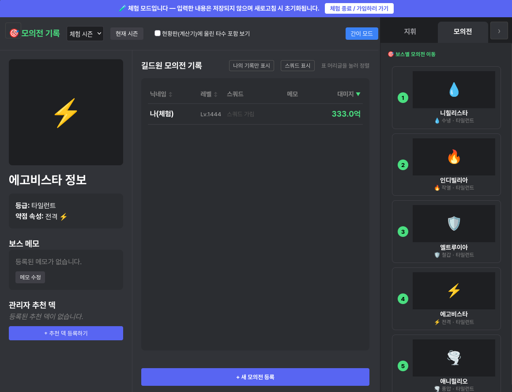
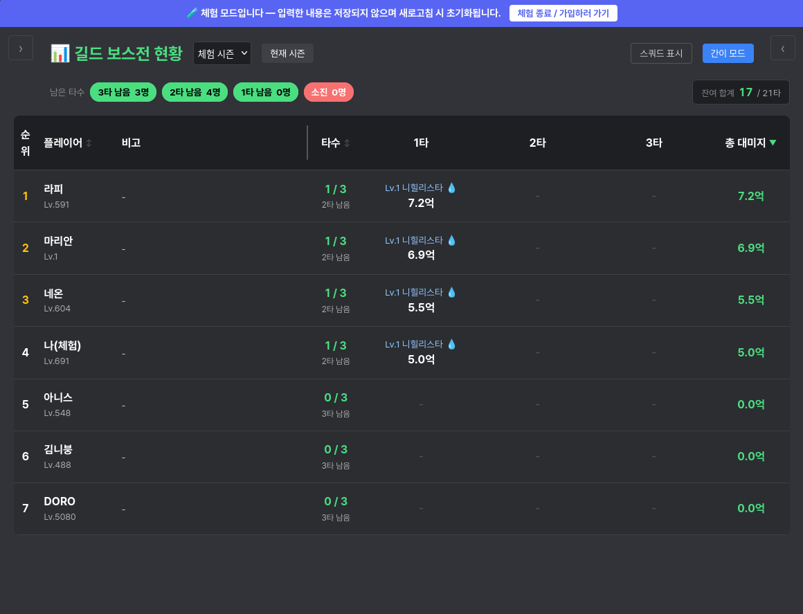

# ギルドボス戦指揮所

スマホゲーム『勝利の女神：NIKKE』のギルド向けに作った、ボス戦攻略のためのリアルタイム協業 Web アプリです。
個人で企画・設計し、実際のユーザーに使ってもらいながら運用・改善を続けています。
コーディングには AI を積極的に活用しましたが、サイトの構想や画面構成、動作の設計はすべて自分で行いました。

> ⚠️ 本プロジェクトは非公式のファンツールです。株式会社 SHIFT UP および Level Infinite とは一切関係ありません。
> ゲーム内画像などの著作権は各権利者に帰属するため、本リポジトリには含めていません。

**デモ**: https://guild-boss-battle.pages.dev/ （ログイン後「体験モード」で全機能を試せます。入力内容は保存されません）

**ユーザー層を韓国語にしか考えていなかったため、韓国語のみサポートしています。**


| 指揮ボード | 模擬戦記録 | 精算 |
| :---: | :---: | :---: |
|  |  |  |

---

## 背景：なぜ作ったのか

NIKKE のギルドボス戦では、メンバー全員が 1 日 3 回までの攻撃回数を使い、5 体のボスの体力を協力して削ります。
最終日のハード難易度は 1 日しかないため、「誰が、どのボスに、どの編成で、どれだけダメージを出すか」を事前に組み合わせないと、攻撃回数が無駄になります。

所属ギルドではこの調整をチャットとスプレッドシートで行っていましたが、

- 模擬戦の記録が流れてしまい、誰の記録が最新かわからない
- 同時に記録を更新すると数字が食い違う
- 残り体力の計算を毎回手作業で行う

といった不便がありました。これを一つの画面で解決するために作り始めました。

**2026年の6月から運用を開始し、定期的に同じギルド員の32名が同時に使っていて、実際の順位上昇にも関わりがありました。**
コミュニケーションが円滑になり、進行状況を一目で確認できたのが最大の長所です。

## 主な機能

| 機能 | 内容 |
| :--- | :--- |
| 🔥 **指揮ボード** | メンバーの模擬戦記録をボスの残り体力に合わせて並べ、シミュレーションしてから実戦の攻撃として確定する（通称「ダメージテトリス」） |
| 📝 **模擬戦記録** | 編成（キャラクター 5 体）とダメージを記録・共有。管理者による代理入力にも対応 |
| 📊 **ランキング・精算** | シーズンごとの攻撃回数・ダメージ・ラストアタックを集計し、確定後は画像として書き出し |
| 💬 **リアルタイムチャット** | チャンネル制チャット、メンション、画像、スタンプ、既読位置の同期、Web Push 通知 |
| 🛠️ **管理画面** | ギルド開設の承認、シーズンとボス体力の登録、通報対応、操作ログの閲覧 |
| 👀 **体験モード** | 未加入ユーザーがメモリ上のダミーデータで全機能を試せるモード |

PC とスマートフォンの両方に対応しており、PWA としてホーム画面に追加できます。
利用者が韓国のプレイヤーのため、画面の表示言語は韓国語です。

## 技術スタック

| 領域 | 技術 |
| :--- | :--- |
| フロントエンド | React 19, Vite, React Router, i18next |
| バックエンド | Supabase（PostgreSQL, Auth, Realtime, Storage, Edge Functions / Deno） |
| ホスティング | Cloudflare Pages |
| その他 | Web Push（Service Worker）, html-to-image, oxlint |

```
┌───────────────────────┐          ┌──────────────────────────────────────┐
│  ブラウザ (React SPA)  │  HTTPS   │  Supabase                            │
│  Vite + PWA           │◄────────►│  ├ Auth        ログイン・セッション     │
│  Service Worker       │   WSS    │  ├ PostgreSQL  約 40 テーブル + RLS + RPC│
└───────────────────────┘          │  ├ Realtime    在席状況・変更通知       │
   Cloudflare Pages で配信          │  ├ Storage     画像                    │
                                   │  └ Edge Fn     Push 送信・画像プロキシ等 │
                                   └──────────────────────────────────────┘
```

### 技術選定の理由

**無料で運用し続けられること**を最優先にしました。
独自サーバーを持たずに認証・DB・リアルタイム通信をまとめて提供してくれる Supabase と、静的サイトを無料で配信できる Cloudflare Pages を組み合わせ、サーバーレス構成にしています。
その分、アクセス制御はすべて PostgreSQL の RLS（Row Level Security）で行う必要があり、権限設計が重要なポイントになりました。

## 工夫した点・苦労した点

### 1. 同時更新でダメージが消える問題
当初はクライアントが残り体力を計算して上書きしていたため、2 人が同時に実戦確定すると片方のダメージが消えるバグがありました。
これを PostgreSQL の関数（RPC）に移し、対象行を `SELECT ... FOR UPDATE` でロックして**サーバー側で原子的に計算**するようにしました。
あわせて「1 日 3 回まで」の上限チェックや、ラストアタック時の超過ダメージの切り捨てもサーバー側で行っています。
（[`supabase/migrations/20260714120000_atomic_real_damage_rpc.sql`](supabase/migrations/20260714120000_atomic_real_damage_rpc.sql)）

### 2. 「同じ人」の判定
本人が入力した記録と、管理者が代理入力した記録が別人として数えられ、3 回の上限をすり抜けるバグがありました。
ユーザー ID とニックネームを統合する識別キーを作り、画面側（[`src/lib/identity.js`](src/lib/identity.js)）と DB 側の両方で同じルールを使うようにしました。

### 3. 権限設計とセキュリティ点検
運用中にセキュリティ点検を行い、RLS の抜け穴（他ギルドのデータが見える、副管理者が権限を上げられる等）を見つけて修正しました。
また、画像プロキシにはホストの許可リストを設けて SSRF を防いでいます。
（[`supabase/migrations/20261014120000_security_hardening.sql`](supabase/migrations/20261014120000_security_hardening.sql)）

### 4. リアルタイム通信の負荷削減
すべての変更を全員が購読していたため、ギルドが増えるほど DB の負荷が増える構造でした。
購読をギルド単位でサーバー側フィルタするように変更し（[`src/lib/realtime.js`](src/lib/realtime.js)）、通信が切れていた間のメッセージを再取得する処理も追加しました。

### 5. デプロイ後に画面が真っ白になる事故
SPA のフォールバック設定により、存在しないファイルへのリクエストが「200 + HTML」で返り、キャッシュされて画面が表示されなくなる事故が 2 回ありました。
キャッシュヘッダの見直し、チャンク読み込み失敗時の自動リロード、デプロイ後に全アセットの Content-Type を検証するスクリプト（[`scripts/verify-deploy.mjs`](scripts/verify-deploy.mjs)）で再発を防いでいます。

## 開発の進め方

開発を始めた時点では Web 開発の経験がほとんどなく、最初はここまでの規模にするつもりもありませんでした。

- **自分の担当**: 課題の発見、画面構成と動作の設計、要件の整理、動作確認、運用とユーザー対応
- **AI（Claude 等）の担当**: 設計に基づくコードの実装

実際にギルドで使ってもらい、出てきた不便や不具合を具体的に書き起こして AI に渡し、結果を確認して取り込む、というサイクルで改善してきました。
コードをすべて自分で書いたわけではありませんが、各機能が画面から DB・権限までどう動くかは説明できるように理解を進めています。

## 今後の改善

- JavaScript から **TypeScript への移行**
- テストの導入（特にダメージ計算と権限まわり）
- 1,000 行を超える大きなコンポーネント（指揮ボード、模擬戦記録など）の分割
- 不要な再描画や再取得を減らすパフォーマンス改善

## ローカルでの起動

> 動作には Supabase プロジェクトとの接続が必須です（認証・DB・リアルタイム通信をすべて Supabase で行っているため）。

```bash
npm install
cp .env.example .env.local   # Supabase の URL と anon key を設定
npm run dev
```

### Supabase 側の DB 構築

新しい Supabase プロジェクトの **SQL Editor** で、次の 3 ファイルを順番に実行します。

1. [`supabase/init.sql`](supabase/init.sql)：テーブル、RLS、関数、トリガー、Storage、Realtime、定期ジョブまで含む DB 全体
2. [`supabase/nikke.sql`](supabase/nikke.sql)：キャラクター（ニケ）の基本データ
3. [`supabase/set_admin.sql`](supabase/set_admin.sql)：サイトで会員登録したアカウントを管理者にする（ファイル内の ID を書き換えてから実行）

`init.sql` は、これまでのマイグレーション（[`supabase/migrations/`](supabase/migrations/)）をすべて適用した最終状態を 1 ファイルにまとめたものです。変更の履歴はマイグレーション側に残しています。

その後、管理画面からシーズンとボスのデータを登録すれば利用できます。
Web Push を使う場合は `supabase functions deploy send-push` でデプロイし、ダッシュボードの Database → Webhooks で `user_notifications` の INSERT を `send-push` に送るよう設定します。

**supabaseの設定で `Authentication` - `Sign in / Provider`の項目のうち、`Confirm email`のところのチェックを解除する必要があります**
あくまで匿名性を保証するための措置で、ユーザーからE-mailアドレスや個人情報を一切受け取らず、IDとパスワードのみで会員登録ができるようにしています。

## ディレクトリ構成

```
src/
├── pages/
│   ├── workspace/   ギルド画面（指揮ボード、模擬戦、チャット、精算）
│   └── admin/       サイト管理画面
├── components/      共通コンポーネント
├── contexts/        認証・ゲームデータ
├── demo/            体験モード
├── hooks/  lib/     共通ロジック
supabase/
├── migrations/      DB スキーマ・RLS・RPC
└── functions/       Edge Functions (Deno)
docs/                設計資料（韓国語）
```
